# eHMIs on vehicles in India and the Netherlands

Online study of how pedestrians in India and the Netherlands read external human-machine interfaces (eHMIs) on vehicles. A collaboration of TU/e and IIT Indore.

Participants view photos of a car, bus, truck or tuk-tuk at 10 or 20 m, taken in India and in the Netherlands, with no eHMI or with one of these eHMIs: English text (WALK / STOP), text in the local language (Chaliye / Rukiye in Hindi, Lopen in Dutch), a green or red symbol, or a green or red light bar. After each photo they rate on 0-100 sliders whether they would cross, how safe they feel, how clear the message is and how quickly they understand what the vehicle intends to do. Eye gaze is recorded with the webcam (WebGazer).

## Experiment
The experiment is built with [jsPsych](https://www.jspsych.org) 8 in `public/views/experiment.html`. A Node.js server (`app.js`, Express and Mongoose) serves it and stores the data in the `entries` collection of a MongoDB database.

### Procedure
1. Images are preloaded and the browser switches to full screen.
2. Device check: phones, tablets and screens smaller than 1280 × 720 px cannot continue.
3. Webcam setup, calibration of the eye tracker (5 points, each clicked twice) and a check of its accuracy; calibration is repeated once if the accuracy is too low or the gaze is frozen (most gaze points at the same position; the camera is then restarted first). Participants are asked to use Google Chrome, as eye tracking works best there.
4. Instructions, demographics (age, education, occupation, nationality, country of residence, gender, walking and crossing habits) and questions on automated vehicles.
5. An introduction to eHMIs.
6. 34 of the 136 stimuli, in random order. Each trial: press C, view the photo for 5 s, answer the 4 slider questions. Five attention checks are mixed in between the trials; three wrong answers end the study.
7. Post-experiment questionnaire on two pages of sliders (trust, preferred eHMI types and combinations, perceived safety per vehicle type, display location) and an open question on improvements.

Data is saved after calibration and after every trial, so the answers of participants who stop early are kept.

### Stimuli
The 136 photos are in `public/img/stimuli_masked/`, with their conditions (country, vehicle, eHMI, distance) in `public/img/stimuli_masked/mapping.csv`. Number plates were masked with `public/img/mask_plates.py` and `mask_plates_interactive.py` and the photos resized to 1280 × 720 px, the size they are shown at. The number of photos per participant is `n_images_per_participant` in `experiment.html`.

### Running the experiment
Install the dependencies with `npm install` and start the server with `CONNECTION='<MongoDB connection string>' npm start`, then open http://localhost:3000. The server needs a reachable MongoDB database; it stops about 30 s after start if it cannot connect. URL parameters:
* `debug=true`: log details to the browser console.
* `save_data=false`: do not send data to the database.
* `eye_tracking=false`: skip the webcam and eye tracking.
* `calibration_num=<n>`: repetitions of each calibration point (default 2).
* `worker_code=<code>`: participant code to store with the data (generated if not given).

The live study runs on Heroku (`Procfile`, Node.js 22), which deploys the `main` branch; the connection string is set there as the `CONNECTION` config variable.

## Analysis
The analysis is in the `ehmi` package (`ehmi/analysis.py`, started by `ehmi/run.py`). Tested with Python 3.11. Set up the environment in the repository folder:

```
pip install -r requirements.txt
```

### Configuration
Settings are read from `config` and secrets from `secret` in the repository folder. Both are not in git: create them from `default.config` and `default.secret`. If there is no `config`, `default.config` is used.

`config`:
* `path_data`: folder with the data exported from MongoDB.
* `files_heroku`: data files in that folder.
* `download_data`: export the data from MongoDB into the first of `files_heroku` before the analysis (needs `mongoexport` and `mongodb_uri` in `secret`).
* `mapping_stimuli`: CSV file with the conditions of each stimulus.
* `stimulus_width`, `stimulus_height`: size of the stimuli on screen in px.
* `min_gaze_distinct`: gaze data of a participant counts as invalid when the share of distinct gaze points is lower than this (frozen gaze).
* `update_readme`: refresh the per-stimulus gaze table in this README.
* `logger_level`: level of the log messages shown.

`secret`:
* `mongodb_uri`: connection string of the MongoDB database, including the password.

### Running the analysis
From the repository folder run `python -m ehmi.run`. To export the data by hand instead: `mongoexport --uri <mongodb_uri> --collection entries --type json --out heroku_0.json`.

Per-participant tables (participants, answers per image, post-experiment questionnaire) are saved to `_output/` and are not in git, as they hold personal data. Figures are saved to `figures/`; the per-stimulus gaze heatmaps go to `figures/gaze/` and the run refreshes their table in this README. Ratings are averaged within each participant first, then across participants.

Frozen gaze (the same gaze point repeated) occurred in Firefox and Chrome. The experiment therefore keeps the webcam video rendered during image trials and restarts the camera after 15 identical consecutive gaze samples (about 0.5 s). Each image trial stores the number of restarts in `gaze_camera_restarts`; the participant table reports their sum.

## Results
Preliminary: N = 18 participants (data from 12 to 21 October 2026; 16 living in India, 1 in Canada, 1 did not say). 10 completed all 34 images; 7 stopped early, after 1 to 28 images, and 1 before the first. The figures are rebuilt by the analysis script as data comes in.

### Ratings by eHMI


### Ratings by vehicle and distance


### Ratings by country of the footage and of participants


### Post-experiment questionnaire


### Eye gaze


### Eye gaze per stimulus
<!-- gaze-per-stimulus:start -->
Gaze (orange, stronger = more) over each stimulus, from the 16 participants with valid gaze data. 128 of 136 stimuli have gaze data so far; n is the number of participants per stimulus.

<table>
<tr><td width="33%">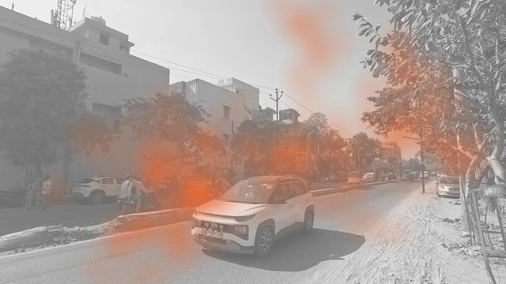<br><sub>Image 1: India, Car, Text local: Chaliye, 10 m (n = 3)</sub></td><td width="33%">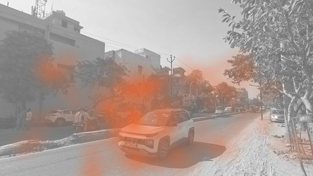<br><sub>Image 2: India, Car, Text local: stop (Rukiye), 10 m (n = 3)</sub></td><td width="33%">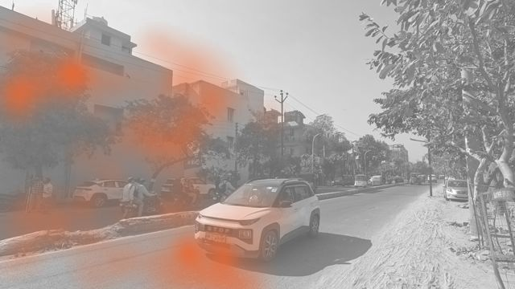<br><sub>Image 3: India, Car, Text English: STOP, 10 m (n = 2)</sub></td></tr>
<tr><td width="33%">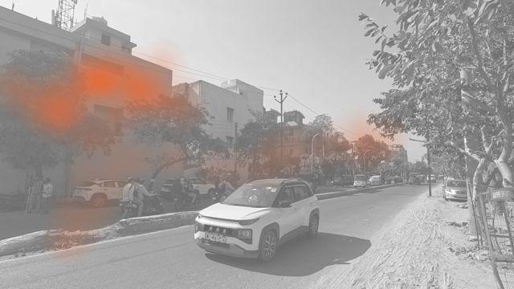<br><sub>Image 4: India, Car, Symbol green, 10 m (n = 1)</sub></td><td width="33%">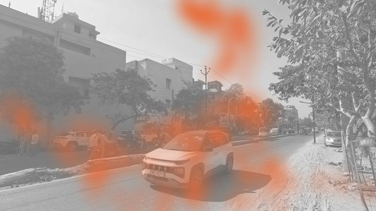<br><sub>Image 5: India, Car, Symbol red, 10 m (n = 2)</sub></td><td width="33%">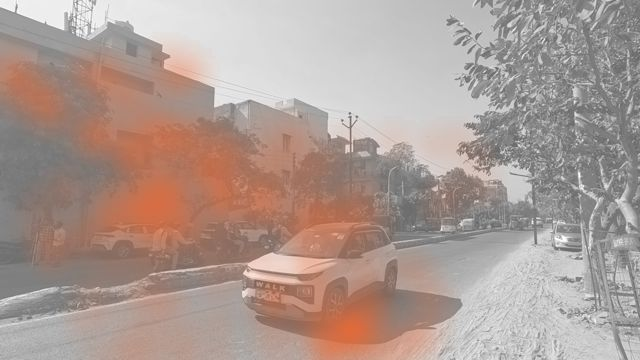<br><sub>Image 6: India, Car, Text English: WALK, 10 m (n = 4)</sub></td></tr>
<tr><td width="33%">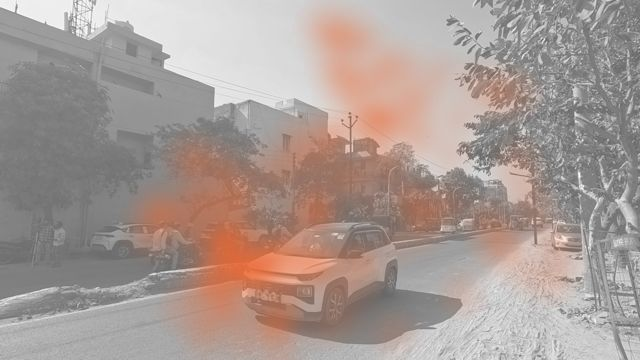<br><sub>Image 7: India, Car, No eHMI, 10 m (n = 2)</sub></td><td width="33%"><br><sub>Image 8: India, Car, Text local: Chaliye, 20 m (n = 4)</sub></td><td width="33%">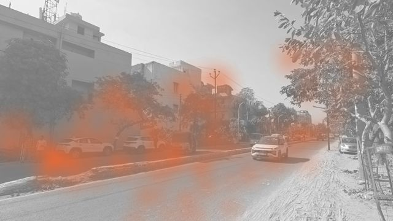<br><sub>Image 9: India, Car, Text local: stop (Rukiye), 20 m (n = 2)</sub></td></tr>
<tr><td width="33%"><br><sub>Image 10: India, Car, Text English: STOP, 20 m (n = 4)</sub></td><td width="33%">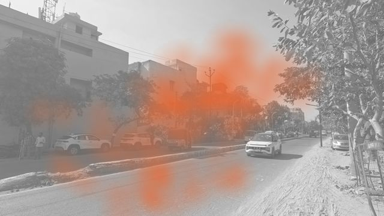<br><sub>Image 11: India, Car, Symbol green, 20 m (n = 2)</sub></td><td width="33%">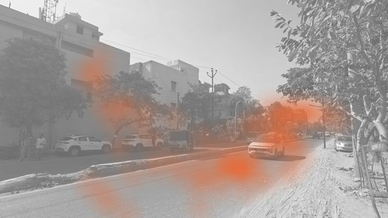<br><sub>Image 12: India, Car, Symbol red, 20 m (n = 1)</sub></td></tr>
<tr><td width="33%">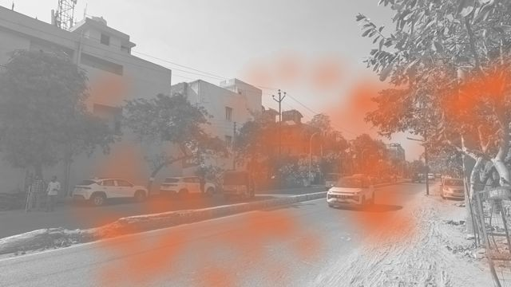<br><sub>Image 13: India, Car, Text English: WALK, 20 m (n = 2)</sub></td><td width="33%"><br><sub>Image 14: India, Car, No eHMI, 20 m (n = 3)</sub></td><td width="33%">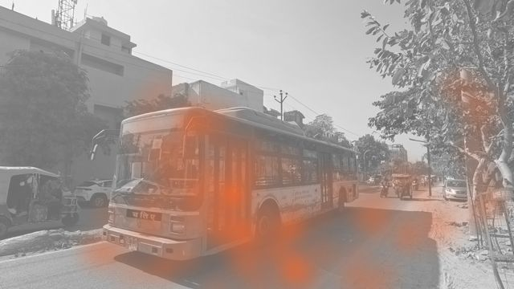<br><sub>Image 15: India, Bus, Text local: Chaliye, 10 m (n = 2)</sub></td></tr>
<tr><td width="33%">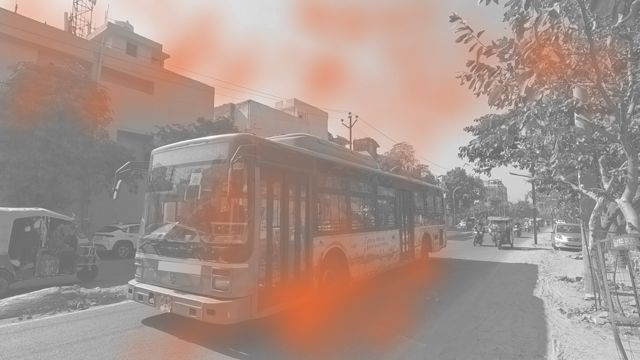<br><sub>Image 16: India, Bus, Light bar green, 10 m (n = 4)</sub></td><td width="33%">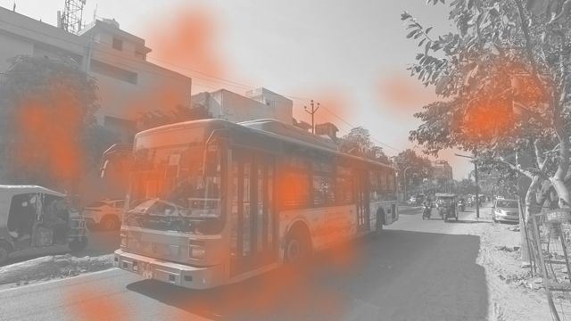<br><sub>Image 17: India, Bus, Light bar red, 10 m (n = 2)</sub></td><td width="33%"><br><sub>Image 18: India, Bus, Text local: stop (Rukiye), 10 m (n = 2)</sub></td></tr>
<tr><td width="33%">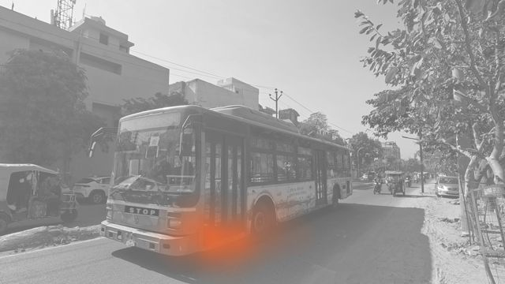<br><sub>Image 19: India, Bus, Text English: STOP, 10 m (n = 5)</sub></td><td width="33%">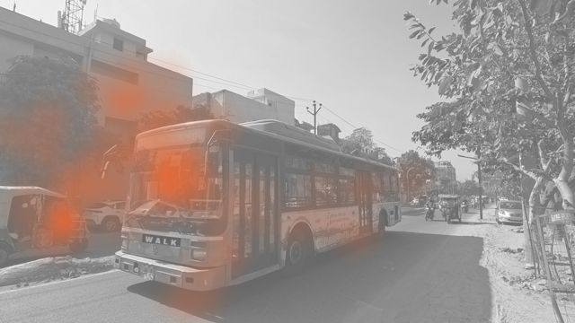<br><sub>Image 20: India, Bus, Text English: WALK, 10 m (n = 2)</sub></td><td width="33%">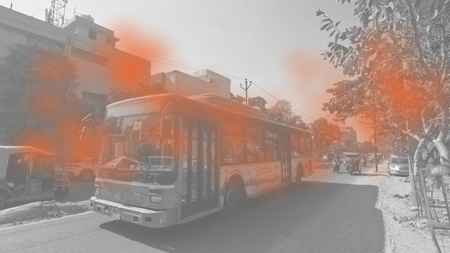<br><sub>Image 21: India, Bus, No eHMI, 10 m (n = 3)</sub></td></tr>
<tr><td width="33%"><br><sub>Image 22: India, Truck, Symbol green, 10 m (n = 5)</sub></td><td width="33%">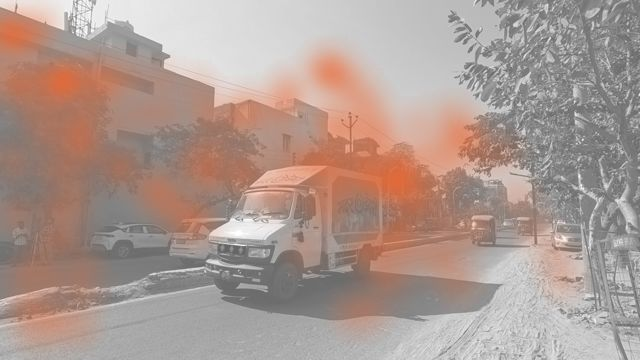<br><sub>Image 23: India, Truck, Symbol red, 10 m (n = 2)</sub></td><td width="33%">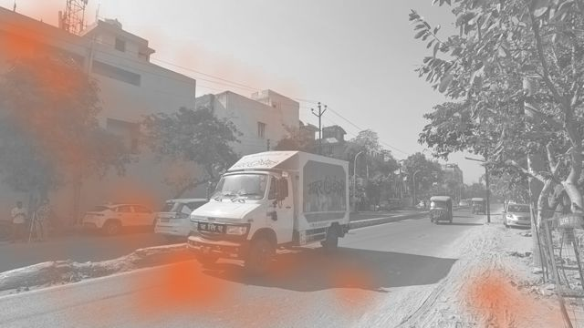<br><sub>Image 24: India, Truck, Text local: Chaliye, 10 m (n = 3)</sub></td></tr>
<tr><td width="33%">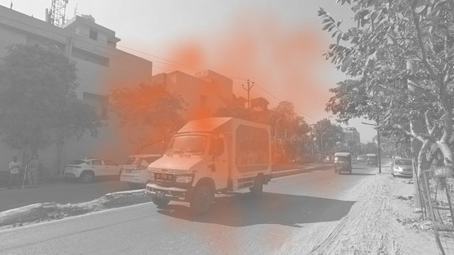<br><sub>Image 25: India, Truck, Text local: stop (Rukiye), 10 m (n = 4)</sub></td><td width="33%"><br><sub>Image 26: India, Truck, Text English: STOP, 10 m (n = 1)</sub></td><td width="33%">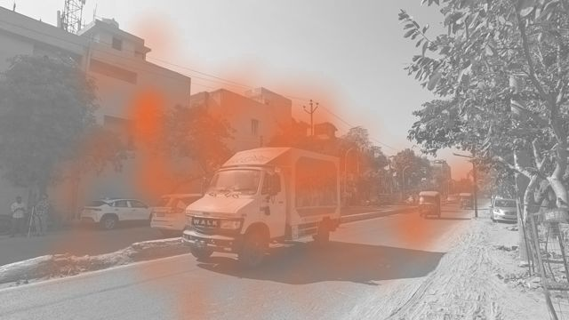<br><sub>Image 27: India, Truck, Text English: WALK, 10 m (n = 5)</sub></td></tr>
<tr><td width="33%">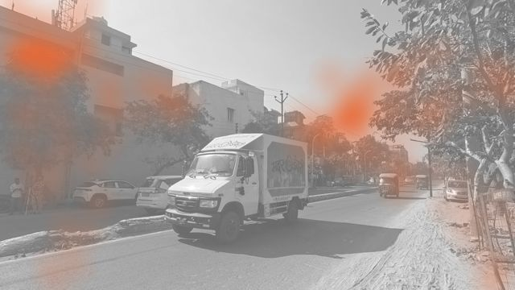<br><sub>Image 28: India, Truck, No eHMI, 10 m (n = 2)</sub></td><td width="33%">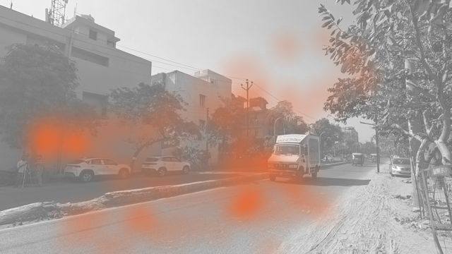<br><sub>Image 29: India, Truck, Text local: Chaliye, 20 m (n = 2)</sub></td><td width="33%">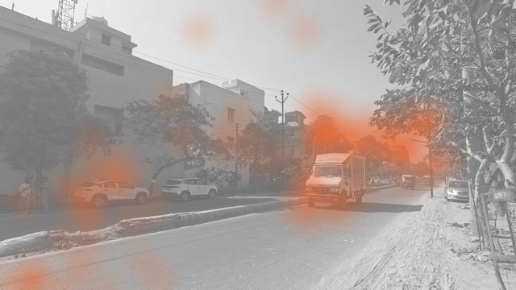<br><sub>Image 30: India, Truck, Text local: stop (Rukiye), 20 m (n = 2)</sub></td></tr>
<tr><td width="33%">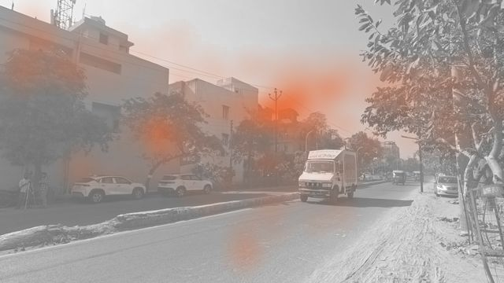<br><sub>Image 32: India, Truck, Symbol green, 20 m (n = 3)</sub></td><td width="33%"><br><sub>Image 33: India, Truck, Symbol red, 20 m (n = 2)</sub></td><td width="33%"><br><sub>Image 34: India, Truck, Text English: WALK, 20 m (n = 3)</sub></td></tr>
<tr><td width="33%"><br><sub>Image 35: India, Truck, No eHMI, 20 m (n = 3)</sub></td><td width="33%">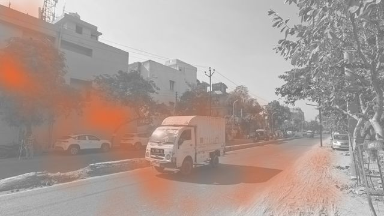<br><sub>Image 36: India, Tuk-Tuk, Text local: Chaliye, 10 m (n = 3)</sub></td><td width="33%">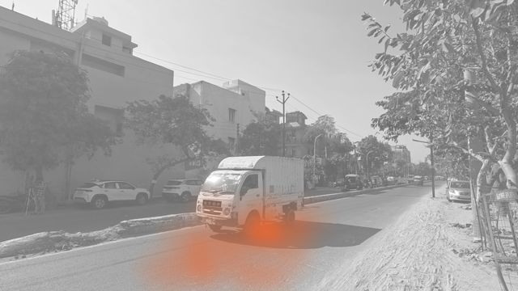<br><sub>Image 38: India, Tuk-Tuk, Text English: STOP, 10 m (n = 1)</sub></td></tr>
<tr><td width="33%">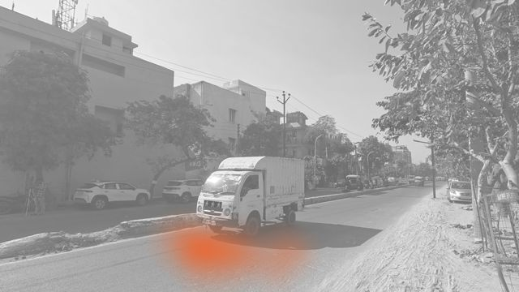<br><sub>Image 39: India, Tuk-Tuk, Symbol green, 10 m (n = 1)</sub></td><td width="33%"><br><sub>Image 40: India, Tuk-Tuk, Symbol red, 10 m (n = 3)</sub></td><td width="33%">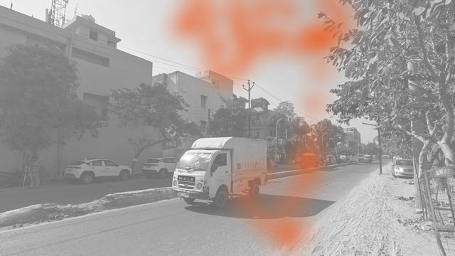<br><sub>Image 41: India, Tuk-Tuk, Text English: WALK, 10 m (n = 1)</sub></td></tr>
<tr><td width="33%">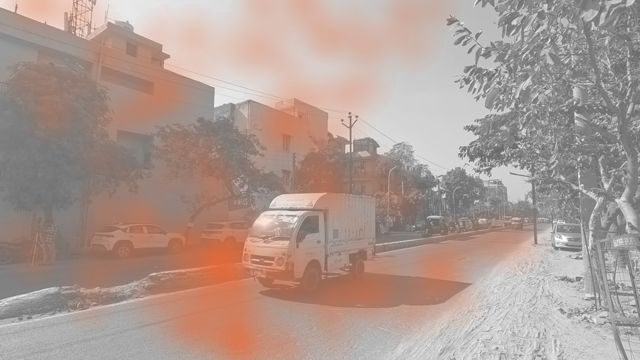<br><sub>Image 42: India, Tuk-Tuk, No eHMI, 10 m (n = 3)</sub></td><td width="33%">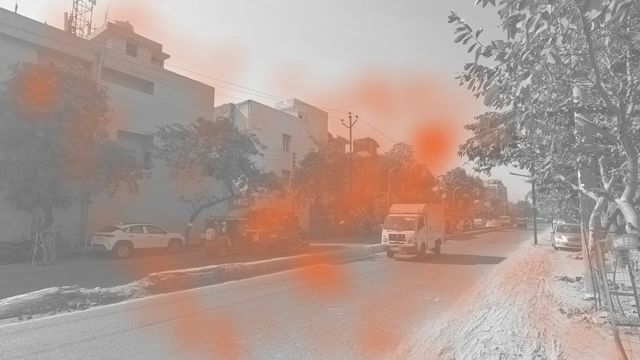<br><sub>Image 43: India, Tuk-Tuk, Text local: Chaliye, 20 m (n = 3)</sub></td><td width="33%">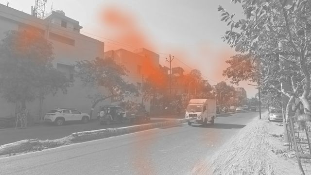<br><sub>Image 44: India, Tuk-Tuk, Text local: stop (Rukiye), 20 m (n = 2)</sub></td></tr>
<tr><td width="33%">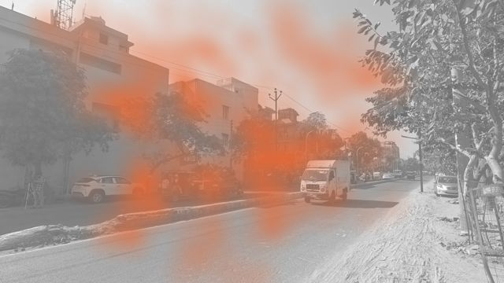<br><sub>Image 45: India, Tuk-Tuk, Text English: STOP, 20 m (n = 4)</sub></td><td width="33%">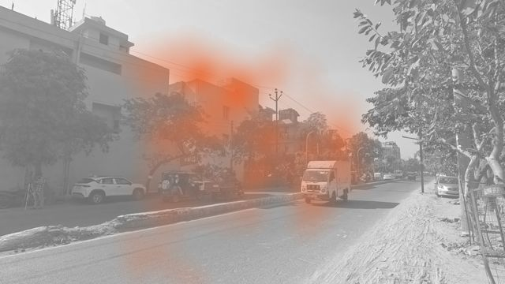<br><sub>Image 46: India, Tuk-Tuk, Symbol green, 20 m (n = 3)</sub></td><td width="33%">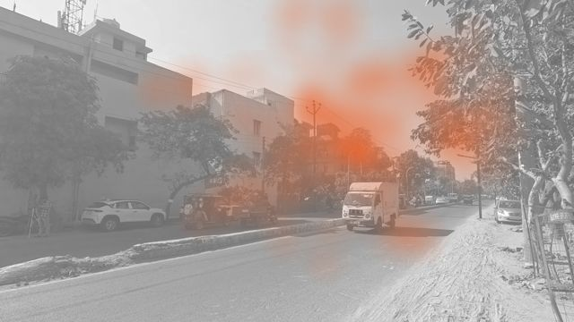<br><sub>Image 47: India, Tuk-Tuk, Symbol red, 20 m (n = 3)</sub></td></tr>
<tr><td width="33%">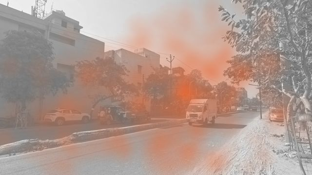<br><sub>Image 48: India, Tuk-Tuk, Text English: WALK, 20 m (n = 7)</sub></td><td width="33%">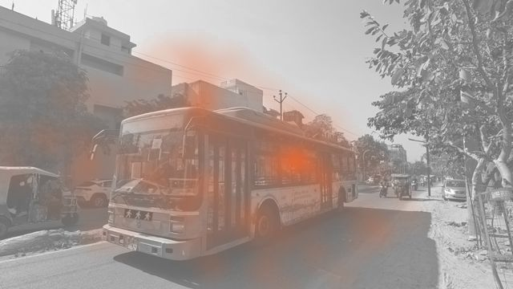<br><sub>Image 50: India, Bus, Symbol green, 10 m (n = 3)</sub></td><td width="33%">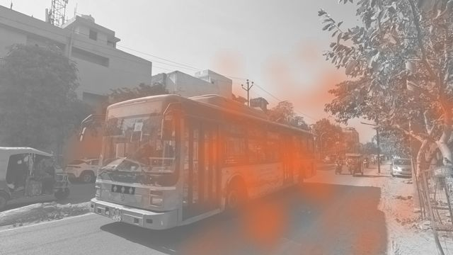<br><sub>Image 51: India, Bus, Symbol red, 10 m (n = 4)</sub></td></tr>
<tr><td width="33%">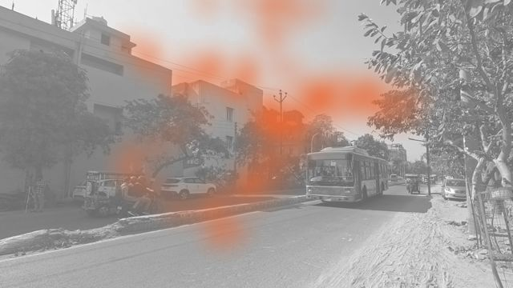<br><sub>Image 52: India, Bus, No eHMI, 20 m (n = 2)</sub></td><td width="33%">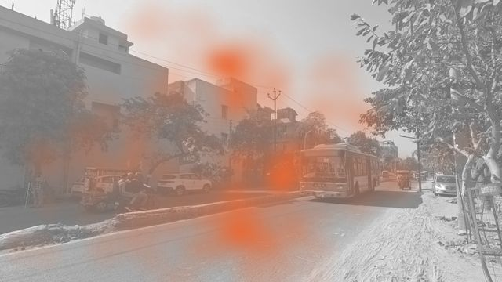<br><sub>Image 53: India, Bus, Text local: Chaliye, 20 m (n = 5)</sub></td><td width="33%"><br><sub>Image 54: India, Bus, Light bar green, 20 m (n = 3)</sub></td></tr>
<tr><td width="33%">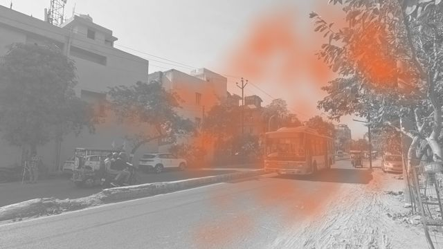<br><sub>Image 55: India, Bus, Light bar red, 20 m (n = 2)</sub></td><td width="33%">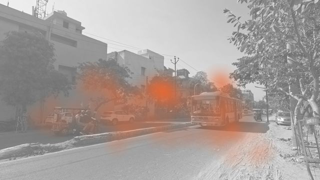<br><sub>Image 56: India, Bus, Text local: stop (Rukiye), 20 m (n = 1)</sub></td><td width="33%">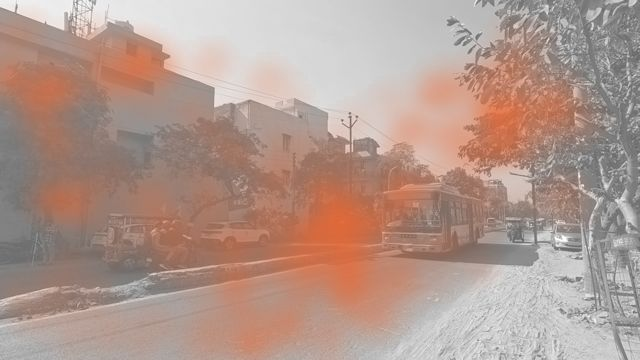<br><sub>Image 57: India, Bus, Text English: STOP, 20 m (n = 5)</sub></td></tr>
<tr><td width="33%">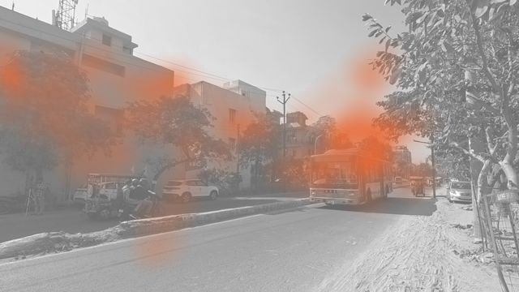<br><sub>Image 58: India, Bus, Symbol green, 20 m (n = 2)</sub></td><td width="33%"><br><sub>Image 59: India, Bus, Symbol red, 20 m (n = 6)</sub></td><td width="33%">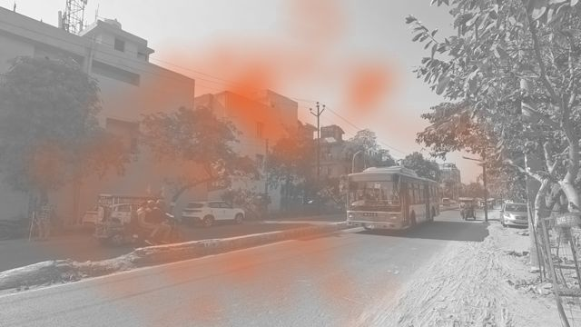<br><sub>Image 60: India, Bus, Text English: WALK, 20 m (n = 3)</sub></td></tr>
<tr><td width="33%">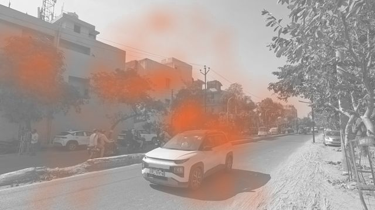<br><sub>Image 61: India, Car, Light bar green, 10 m (n = 4)</sub></td><td width="33%">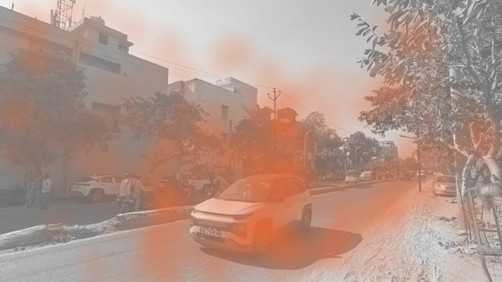<br><sub>Image 62: India, Car, Light bar red, 10 m (n = 7)</sub></td><td width="33%">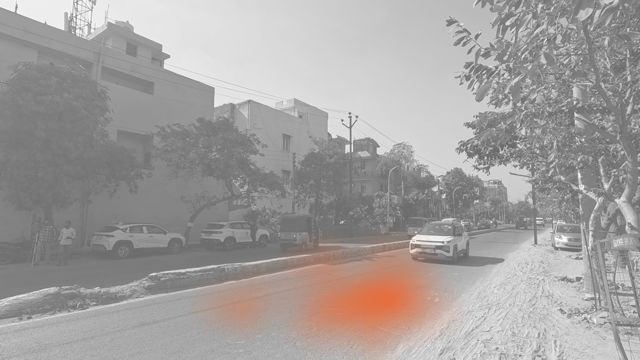<br><sub>Image 63: India, Car, Light bar green, 20 m (n = 3)</sub></td></tr>
<tr><td width="33%"><br><sub>Image 64: India, Car, Light bar red, 20 m (n = 2)</sub></td><td width="33%"><br><sub>Image 65: India, Truck, Light bar green, 10 m (n = 2)</sub></td><td width="33%">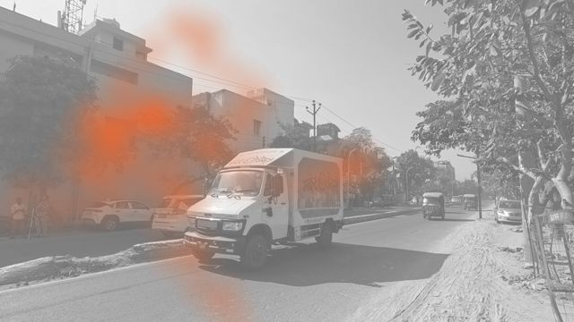<br><sub>Image 66: India, Truck, Light bar red, 10 m (n = 1)</sub></td></tr>
<tr><td width="33%"><br><sub>Image 67: India, Truck, Light bar green, 20 m (n = 4)</sub></td><td width="33%"><br><sub>Image 68: India, Truck, Light bar red, 20 m (n = 3)</sub></td><td width="33%">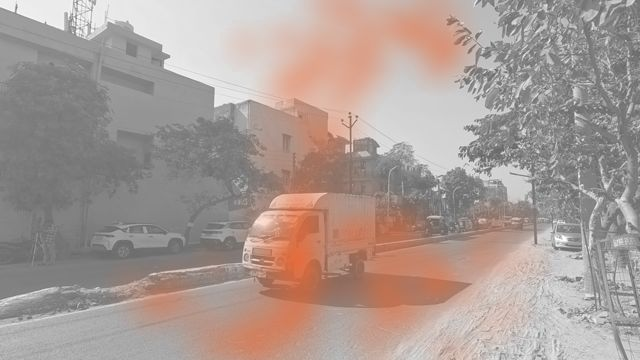<br><sub>Image 69: India, Tuk-Tuk, Light bar green, 10 m (n = 3)</sub></td></tr>
<tr><td width="33%"><br><sub>Image 70: India, Tuk-Tuk, Light bar red, 10 m (n = 1)</sub></td><td width="33%"><br><sub>Image 71: India, Tuk-Tuk, Light bar green, 20 m (n = 2)</sub></td><td width="33%"><br><sub>Image 72: India, Tuk-Tuk, Light bar red, 20 m (n = 1)</sub></td></tr>
<tr><td width="33%"><br><sub>Image 73: NL, Bus, No eHMI, 10 m (n = 4)</sub></td><td width="33%"><br><sub>Image 75: NL, Bus, Light bar green, 10 m (n = 6)</sub></td><td width="33%"><br><sub>Image 76: NL, Bus, Text local: Lopen, 10 m (n = 4)</sub></td></tr>
<tr><td width="33%"><br><sub>Image 77: NL, Bus, Symbol red, 10 m (n = 2)</sub></td><td width="33%"><br><sub>Image 78: NL, Bus, Light bar red, 10 m (n = 6)</sub></td><td width="33%"><br><sub>Image 79: NL, Bus, Text English: STOP, 10 m (n = 4)</sub></td></tr>
<tr><td width="33%"><br><sub>Image 80: NL, Bus, Text English: WALK, 10 m (n = 5)</sub></td><td width="33%"><br><sub>Image 81: NL, Bus, No eHMI, 20 m (n = 1)</sub></td><td width="33%"><br><sub>Image 82: NL, Bus, Symbol green, 20 m (n = 1)</sub></td></tr>
<tr><td width="33%"><br><sub>Image 83: NL, Bus, Light bar green, 20 m (n = 7)</sub></td><td width="33%"><br><sub>Image 84: NL, Bus, Text local: Lopen, 20 m (n = 1)</sub></td><td width="33%"><br><sub>Image 85: NL, Bus, Symbol red, 20 m (n = 2)</sub></td></tr>
<tr><td width="33%"><br><sub>Image 86: NL, Bus, Light bar red, 20 m (n = 5)</sub></td><td width="33%"><br><sub>Image 88: NL, Bus, Text English: WALK, 20 m (n = 1)</sub></td><td width="33%"><br><sub>Image 89: NL, Car, No eHMI, 10 m (n = 2)</sub></td></tr>
<tr><td width="33%"><br><sub>Image 90: NL, Car, Light bar green, 10 m (n = 5)</sub></td><td width="33%"><br><sub>Image 91: NL, Car, Symbol green, 10 m (n = 4)</sub></td><td width="33%"><br><sub>Image 92: NL, Car, Text local: Lopen, 10 m (n = 2)</sub></td></tr>
<tr><td width="33%"><br><sub>Image 94: NL, Car, Symbol red, 10 m (n = 2)</sub></td><td width="33%"><br><sub>Image 95: NL, Car, Text English: STOP, 10 m (n = 4)</sub></td><td width="33%"><br><sub>Image 96: NL, Car, Text English: WALK, 10 m (n = 2)</sub></td></tr>
<tr><td width="33%"><br><sub>Image 97: NL, Car, No eHMI, 20 m (n = 5)</sub></td><td width="33%"><br><sub>Image 98: NL, Car, Light bar green, 20 m (n = 1)</sub></td><td width="33%"><br><sub>Image 99: NL, Car, Symbol green, 20 m (n = 2)</sub></td></tr>
<tr><td width="33%"><br><sub>Image 100: NL, Car, Text local: Lopen, 20 m (n = 4)</sub></td><td width="33%"><br><sub>Image 101: NL, Car, Light bar red, 20 m (n = 4)</sub></td><td width="33%"><br><sub>Image 102: NL, Car, Symbol red, 20 m (n = 3)</sub></td></tr>
<tr><td width="33%"><br><sub>Image 103: NL, Car, Text English: STOP, 20 m (n = 4)</sub></td><td width="33%"><br><sub>Image 104: NL, Car, Text English: WALK, 20 m (n = 2)</sub></td><td width="33%"><br><sub>Image 105: NL, Truck, No eHMI, 10 m (n = 5)</sub></td></tr>
<tr><td width="33%"><br><sub>Image 106: NL, Truck, Light bar green, 10 m (n = 4)</sub></td><td width="33%"><br><sub>Image 107: NL, Truck, Text local: Lopen, 10 m (n = 3)</sub></td><td width="33%"><br><sub>Image 108: NL, Truck, Light bar red, 10 m (n = 2)</sub></td></tr>
<tr><td width="33%"><br><sub>Image 109: NL, Truck, Text English: STOP, 10 m (n = 2)</sub></td><td width="33%"><br><sub>Image 110: NL, Truck, Symbol green, 10 m (n = 6)</sub></td><td width="33%"><br><sub>Image 111: NL, Truck, Symbol red, 10 m (n = 3)</sub></td></tr>
<tr><td width="33%"><br><sub>Image 112: NL, Truck, No eHMI, 20 m (n = 3)</sub></td><td width="33%"><br><sub>Image 113: NL, Truck, Light bar green, 20 m (n = 4)</sub></td><td width="33%"><br><sub>Image 114: NL, Truck, Text local: Lopen, 20 m (n = 3)</sub></td></tr>
<tr><td width="33%"><br><sub>Image 115: NL, Truck, Light bar red, 20 m (n = 3)</sub></td><td width="33%"><br><sub>Image 117: NL, Truck, Symbol green, 20 m (n = 2)</sub></td><td width="33%"><br><sub>Image 118: NL, Truck, Symbol red, 20 m (n = 3)</sub></td></tr>
<tr><td width="33%"><br><sub>Image 119: NL, Truck, Text English: WALK, 20 m (n = 2)</sub></td><td width="33%"><br><sub>Image 120: NL, Truck, Text English: WALK, 10 m (n = 4)</sub></td><td width="33%"><br><sub>Image 121: NL, Tuk-Tuk, No eHMI, 10 m (n = 5)</sub></td></tr>
<tr><td width="33%"><br><sub>Image 122: NL, Tuk-Tuk, Light bar green, 10 m (n = 5)</sub></td><td width="33%"><br><sub>Image 123: NL, Tuk-Tuk, Text local: Lopen, 10 m (n = 1)</sub></td><td width="33%"><br><sub>Image 124: NL, Tuk-Tuk, Light bar red, 10 m (n = 1)</sub></td></tr>
<tr><td width="33%"><br><sub>Image 125: NL, Tuk-Tuk, Text English: STOP, 10 m (n = 2)</sub></td><td width="33%"><br><sub>Image 126: NL, Tuk-Tuk, Symbol green, 10 m (n = 3)</sub></td><td width="33%"><br><sub>Image 127: NL, Tuk-Tuk, Symbol red, 10 m (n = 1)</sub></td></tr>
<tr><td width="33%"><br><sub>Image 128: NL, Tuk-Tuk, Text English: WALK, 10 m (n = 2)</sub></td><td width="33%"><br><sub>Image 129: NL, Tuk-Tuk, No eHMI, 20 m (n = 2)</sub></td><td width="33%"><br><sub>Image 130: NL, Tuk-Tuk, Light bar green, 20 m (n = 4)</sub></td></tr>
<tr><td width="33%"><br><sub>Image 131: NL, Tuk-Tuk, Text local: Lopen, 20 m (n = 6)</sub></td><td width="33%"><br><sub>Image 132: NL, Tuk-Tuk, Light bar red, 20 m (n = 3)</sub></td><td width="33%"><br><sub>Image 133: NL, Tuk-Tuk, Text English: STOP, 20 m (n = 5)</sub></td></tr>
<tr><td width="33%"><br><sub>Image 134: NL, Tuk-Tuk, Symbol green, 20 m (n = 3)</sub></td><td width="33%"><br><sub>Image 136: NL, Tuk-Tuk, Text English: WALK, 20 m (n = 4)</sub></td></tr>
</table>
<!-- gaze-per-stimulus:end -->
