# eHMIs on vehicles in India and the Netherlands

Online study of how pedestrians in India and the Netherlands read external human-machine interfaces (eHMIs) on vehicles. A collaboration of TU/e and IIT Indore.

Participants view photos of a car, bus, truck or tuk-tuk at 10 or 20 m, taken in India and in the Netherlands, with no eHMI or with one of these eHMIs: English text (WALK / STOP), text in the local language (Chaliye / Rukiye in Hindi, Lopen in Dutch), a green or red symbol, or a green or red light bar. After each photo they rate on 0-100 sliders whether they would cross, how safe they feel, how clear the message is and how quickly they understand what the vehicle intends to do. Eye gaze is recorded with the webcam (WebGazer).

## Experiment
The experiment is built with [jsPsych](https://www.jspsych.org) 8 in `public/views/experiment.html`. A Node.js server (`app.js`, Express and Mongoose) serves it and stores the data in the `entries` collection of a MongoDB database.

### Procedure
1. Images are preloaded and the browser switches to full screen.
2. Device check: phones, tablets and screens smaller than 1280 × 720 px cannot continue.
3. Webcam setup, calibration of the eye tracker (5 points, each clicked twice) and a check of its accuracy; calibration is repeated once if the accuracy is too low. Participants are asked to use Google Chrome, as eye tracking works best there.
4. Instructions, demographics (age, education, occupation, nationality, country of residence, gender, walking and crossing habits) and questions on automated vehicles.
5. An introduction to eHMIs.
6. 34 of the 136 stimuli, in random order. Each trial: press C, view the photo for 5 s, answer the 4 slider questions. Five attention checks are mixed in between the trials; three wrong answers end the study.
7. Post-experiment questionnaire on two pages of sliders (trust, preferred eHMI types and combinations, perceived safety per vehicle type, display location) and an open question on improvements.

Data is saved after calibration and after every trial, so the answers of participants who stop early are kept.

### Stimuli
The 136 photos are in `public/img/stimuli_masked/`, with their conditions (country, vehicle, eHMI, distance) in `public/img/stimuli_masked/mapping.csv`. Number plates were masked with `public/img/mask_plates.py` and `mask_plates_interactive.py` and the photos resized to 1280 × 720 px, the size they are shown at. The number of photos per participant is `n_images_per_participant` in `experiment.html`.

### Running the experiment
Install the dependencies with `npm install` and start the server with `CONNECTION='<MongoDB connection string>' npm start`, then open http://localhost:3000. The server needs a reachable MongoDB database; it stops about 30 s after start if it cannot connect. URL parameters:
* `debug=true`: log details to the browser console.
* `save_data=false`: do not send data to the database.
* `eye_tracking=false`: skip the webcam and eye tracking.
* `calibration_num=<n>`: repetitions of each calibration point (default 2).
* `worker_code=<code>`: participant code to store with the data (generated if not given).

The live study runs on Heroku (`Procfile`, Node.js 22), which deploys the `main` branch; the connection string is set there as the `CONNECTION` config variable.

## Analysis
The analysis is in the `ehmi` package (`ehmi/analysis.py`, started by `ehmi/run.py`). Tested with Python 3.11. Set up the environment in the repository folder:

```
pip install -r requirements.txt
```

### Configuration
Settings are read from `config` and secrets from `secret` in the repository folder. Both are not in git: create them from `default.config` and `default.secret`. If there is no `config`, `default.config` is used.

`config`:
* `path_data`: folder with the data exported from MongoDB.
* `files_heroku`: data files in that folder.
* `download_data`: export the data from MongoDB into the first of `files_heroku` before the analysis (needs `mongoexport` and `mongodb_uri` in `secret`).
* `mapping_stimuli`: CSV file with the conditions of each stimulus.
* `stimulus_width`, `stimulus_height`: size of the stimuli on screen in px.
* `min_gaze_distinct`: gaze data of a participant counts as invalid when the share of distinct gaze points is lower than this (frozen gaze).
* `update_readme`: refresh the per-stimulus gaze table in this README.
* `logger_level`: level of the log messages shown.

`secret`:
* `mongodb_uri`: connection string of the MongoDB database, including the password.

### Running the analysis
From the repository folder run `python -m ehmi.run`. To export the data by hand instead: `mongoexport --uri <mongodb_uri> --collection entries --type json --out heroku_0.json`.

Per-participant tables (participants, answers per image, post-experiment questionnaire) are saved to `_output/` and are not in git, as they hold personal data. Figures are saved to `figures/`; the per-stimulus gaze heatmaps go to `figures/gaze/` and the run refreshes their table in this README. Ratings are averaged within each participant first, then across participants.

Frozen gaze (the same gaze point repeated) occurred in Firefox and Chrome. The experiment therefore keeps the webcam video rendered during image trials and restarts the camera after 15 identical consecutive gaze samples (about 0.5 s). Each image trial stores the number of restarts in `gaze_camera_restarts`; the participant table reports their sum.

## Results
Preliminary: N = 2 participants (data from 13 October 2026; both living in India, one stopped after 28 of 34 images). The figures are rebuilt by the analysis script as data comes in.

### Ratings by eHMI
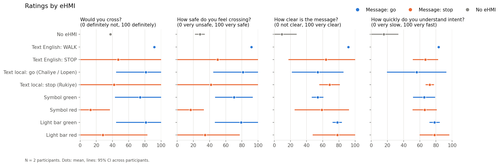

### Ratings by vehicle and distance
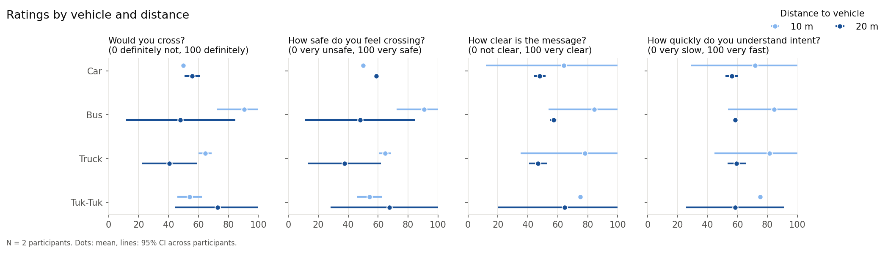

### Ratings by country of the footage and of participants
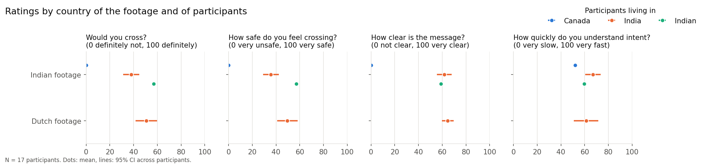

### Post-experiment questionnaire
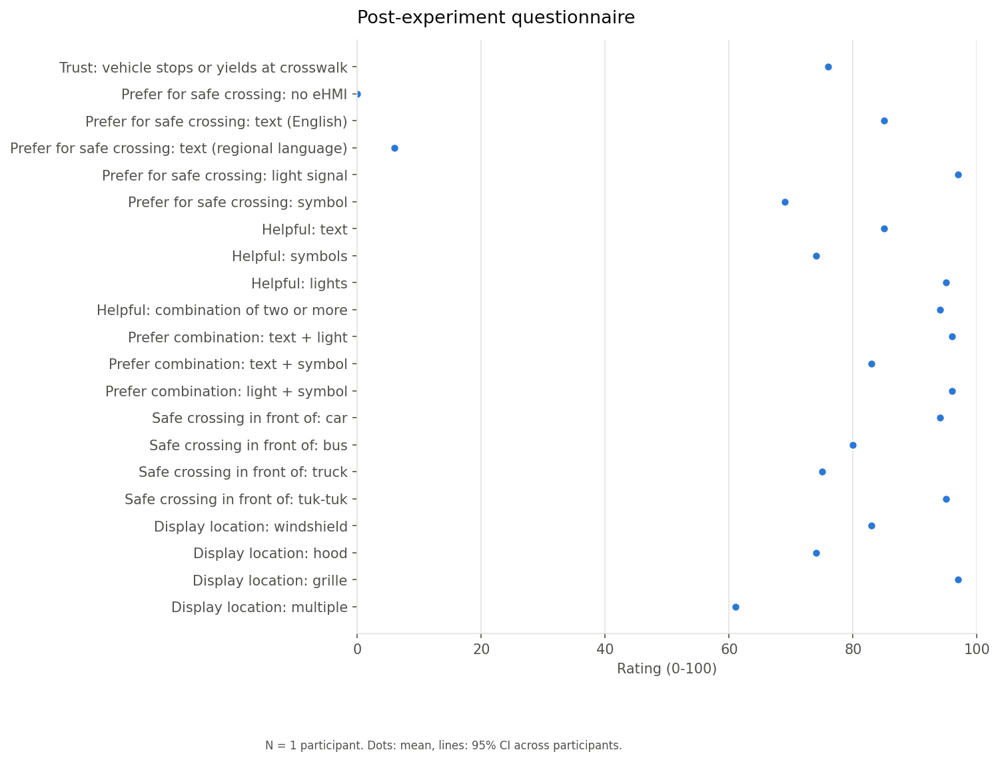

### Eye gaze
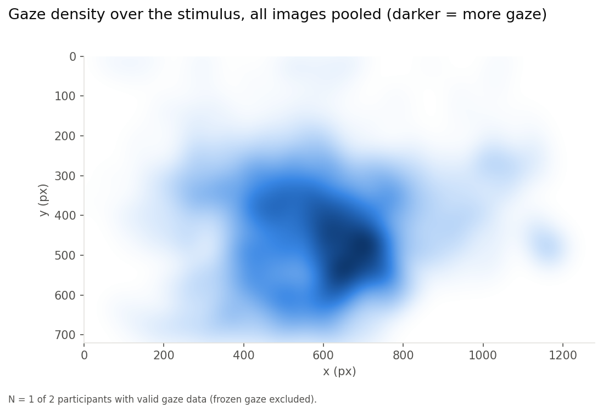

### Eye gaze per stimulus
<!-- gaze-per-stimulus:start -->
Gaze (orange, stronger = more) over each stimulus, from the 1 participant with valid gaze data. 28 of 136 stimuli have gaze data so far; n is the number of participants per stimulus.

<table>
<tr><td width="33%">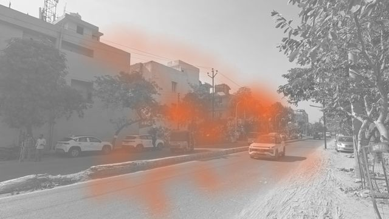<br><sub>Image 8: India, Car, Text local: Chaliye, 20 m (n = 1)</sub></td><td width="33%">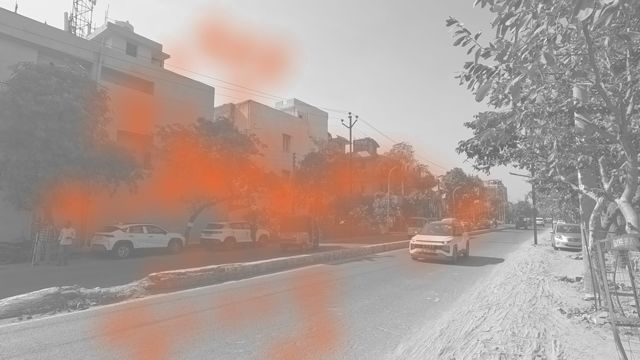<br><sub>Image 10: India, Car, Text English: STOP, 20 m (n = 1)</sub></td><td width="33%">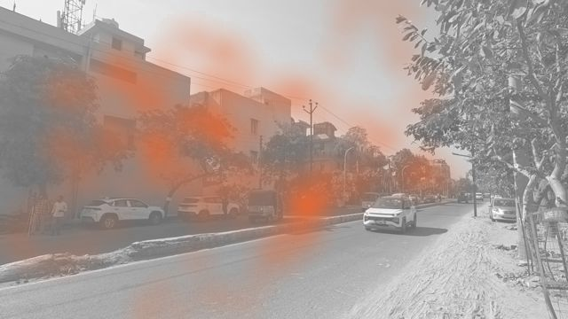<br><sub>Image 14: India, Car, No eHMI, 20 m (n = 1)</sub></td></tr>
<tr><td width="33%">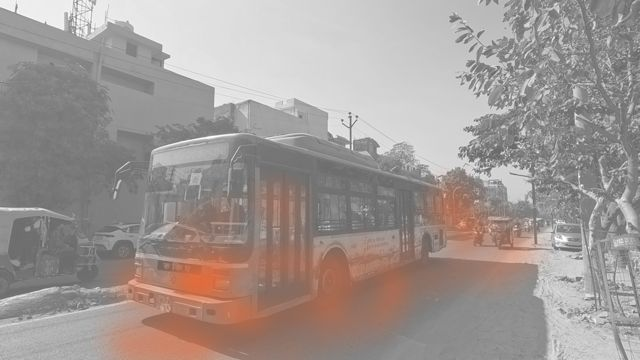<br><sub>Image 18: India, Bus, Text local: stop (Rukiye), 10 m (n = 1)</sub></td><td width="33%">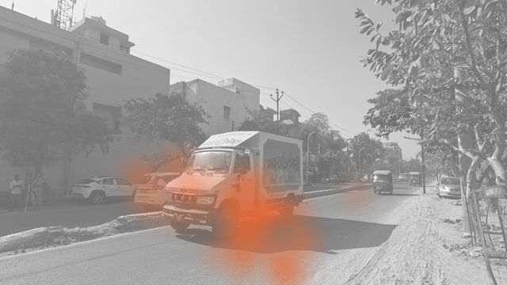<br><sub>Image 22: India, Truck, Symbol green, 10 m (n = 1)</sub></td><td width="33%">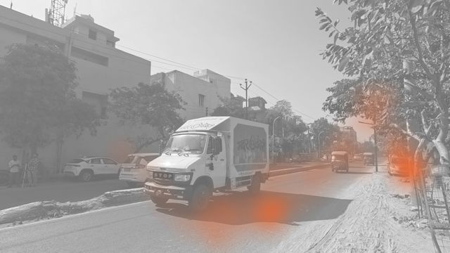<br><sub>Image 26: India, Truck, Text English: STOP, 10 m (n = 1)</sub></td></tr>
<tr><td width="33%">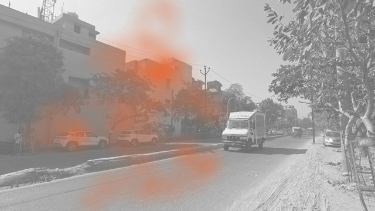<br><sub>Image 33: India, Truck, Symbol red, 20 m (n = 1)</sub></td><td width="33%">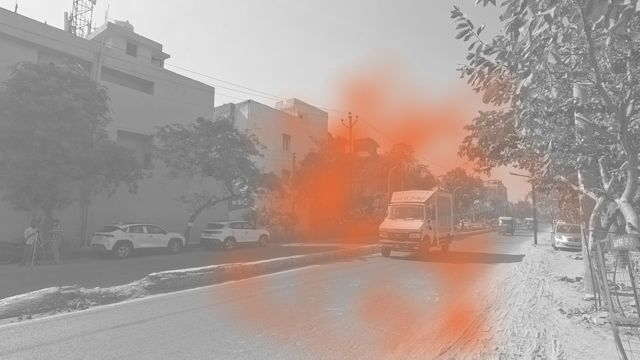<br><sub>Image 35: India, Truck, No eHMI, 20 m (n = 1)</sub></td><td width="33%">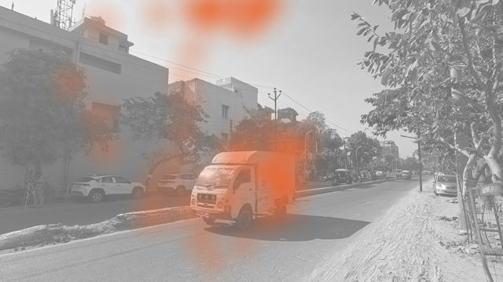<br><sub>Image 40: India, Tuk-Tuk, Symbol red, 10 m (n = 1)</sub></td></tr>
<tr><td width="33%">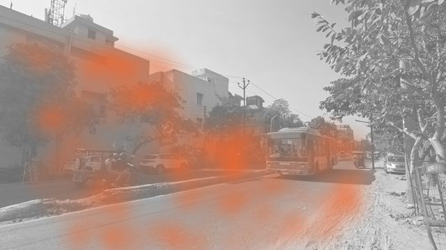<br><sub>Image 54: India, Bus, Light bar green, 20 m (n = 1)</sub></td><td width="33%">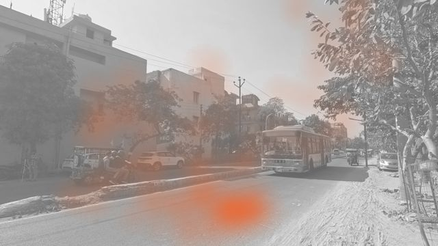<br><sub>Image 59: India, Bus, Symbol red, 20 m (n = 1)</sub></td><td width="33%">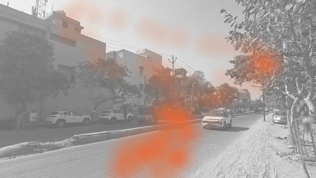<br><sub>Image 64: India, Car, Light bar red, 20 m (n = 1)</sub></td></tr>
<tr><td width="33%">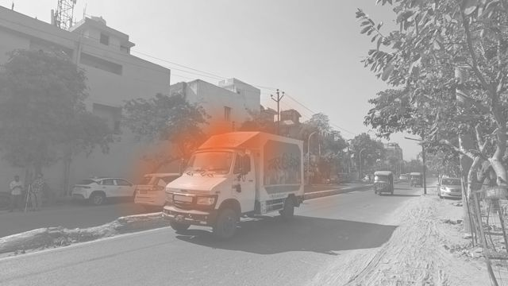<br><sub>Image 65: India, Truck, Light bar green, 10 m (n = 1)</sub></td><td width="33%">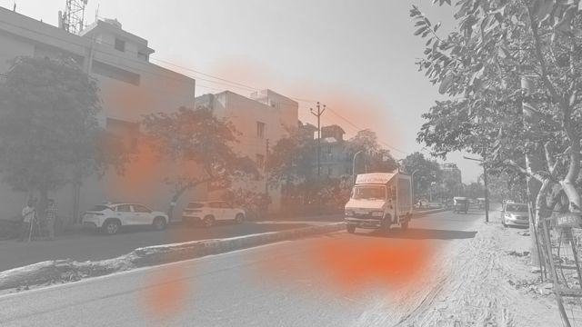<br><sub>Image 67: India, Truck, Light bar green, 20 m (n = 1)</sub></td><td width="33%">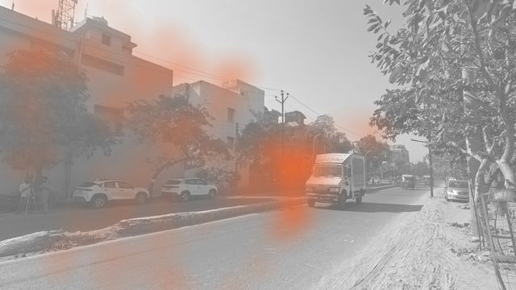<br><sub>Image 68: India, Truck, Light bar red, 20 m (n = 1)</sub></td></tr>
<tr><td width="33%">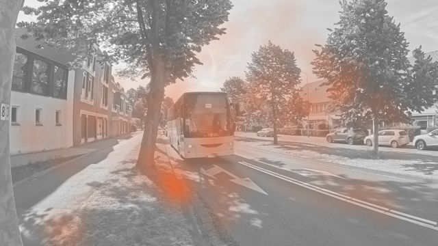<br><sub>Image 73: NL, Bus, No eHMI, 10 m (n = 1)</sub></td><td width="33%">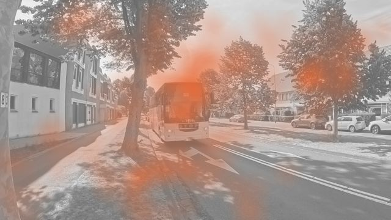<br><sub>Image 79: NL, Bus, Text English: STOP, 10 m (n = 1)</sub></td><td width="33%">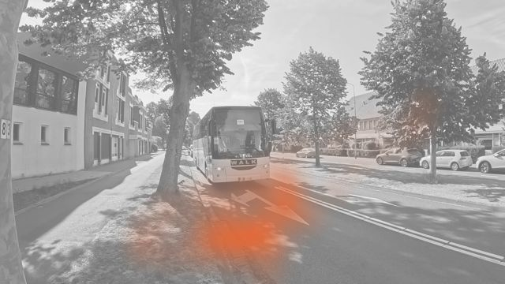<br><sub>Image 80: NL, Bus, Text English: WALK, 10 m (n = 1)</sub></td></tr>
<tr><td width="33%">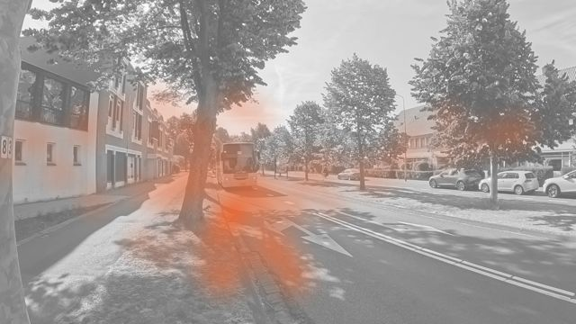<br><sub>Image 86: NL, Bus, Light bar red, 20 m (n = 1)</sub></td><td width="33%">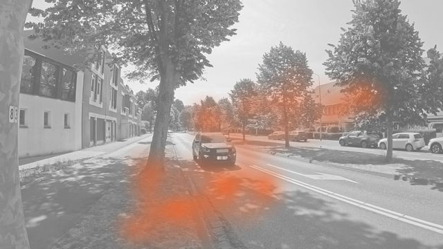<br><sub>Image 90: NL, Car, Light bar green, 10 m (n = 1)</sub></td><td width="33%">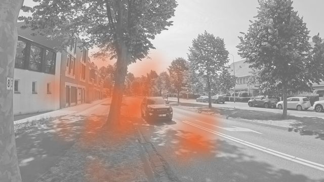<br><sub>Image 92: NL, Car, Text local: Lopen, 10 m (n = 1)</sub></td></tr>
<tr><td width="33%">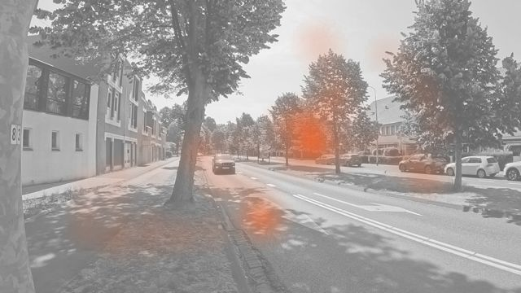<br><sub>Image 99: NL, Car, Symbol green, 20 m (n = 1)</sub></td><td width="33%">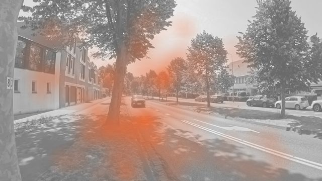<br><sub>Image 103: NL, Car, Text English: STOP, 20 m (n = 1)</sub></td><td width="33%">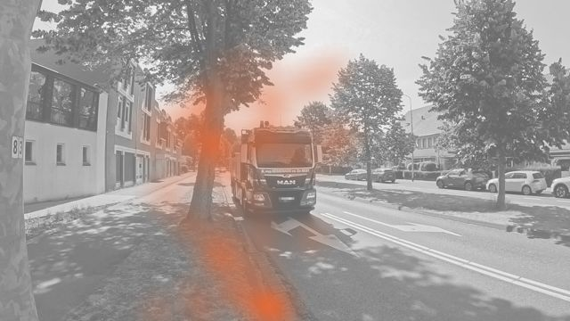<br><sub>Image 105: NL, Truck, No eHMI, 10 m (n = 1)</sub></td></tr>
<tr><td width="33%">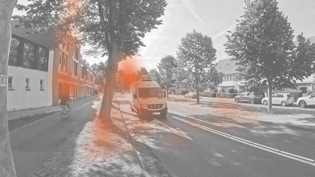<br><sub>Image 126: NL, Tuk-Tuk, Symbol green, 10 m (n = 1)</sub></td><td width="33%">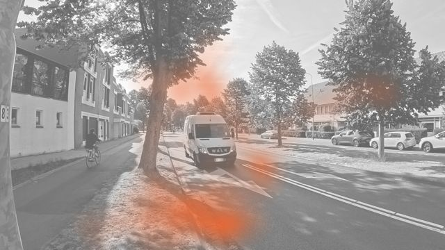<br><sub>Image 128: NL, Tuk-Tuk, Text English: WALK, 10 m (n = 1)</sub></td><td width="33%">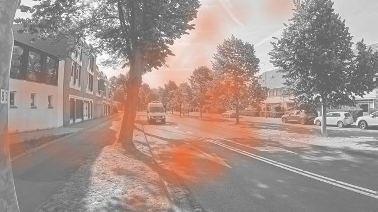<br><sub>Image 132: NL, Tuk-Tuk, Light bar red, 20 m (n = 1)</sub></td></tr>
<tr><td width="33%">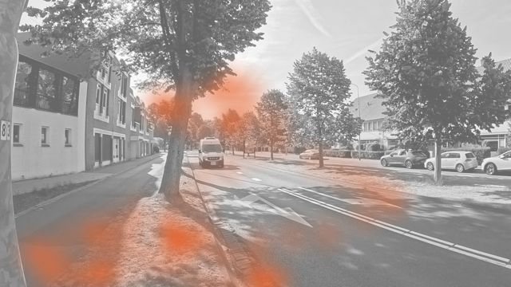<br><sub>Image 136: NL, Tuk-Tuk, Text English: WALK, 20 m (n = 1)</sub></td></tr>
</table>
<!-- gaze-per-stimulus:end -->
